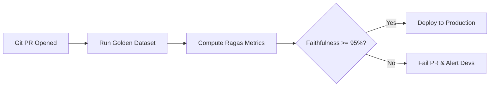

In traditional software engineering, unit testing is straightforward:
```python
assert calculate_tax(100.0) == 8.25
```

With generative AI systems, outputs are non-deterministic, open-ended, and natural-language based. You cannot simply use `assert response == expected_answer`. 

To ship AI applications with confidence, you need an automated **evaluation pipeline (Eval)** that measures performance systematically.

---

## The Golden Triad of RAG Metrics

When evaluating retrieval-augmented applications, the industry standard framework (**Ragas**) evaluates three orthogonal pillars:

### 1. Faithfulness (Groundedness)
- **Question**: *Did the LLM fabricate information not present in the retrieved context?*
- **Measurement**: Breaks the model's generated answer into individual claims, checking whether each claim can be logically deduced from the retrieved context.
- **Goal**: High faithfulness ensures zero hallucinations.

### 2. Answer Relevance
- **Question**: *Did the answer directly address the question that was asked?*
- **Measurement**: Re-generates potential questions from the answer and compares their semantic alignment to the original user query.
- **Goal**: Prevents vague or evasive responses.

### 3. Context Relevance
- **Question**: *Did the retrieval step return clean, focused information, or noisy paragraphs?*
- **Measurement**: Calculates the proportion of retrieved sentences that were strictly necessary to answer the prompt.
- **Goal**: Keeps vector retrieval accurate and reduces token waste.

---

## LLM-as-a-Judge: Automated Scoring

Rather than employing humans to read thousands of test runs, engineers use a stronger, more deterministic judge model (e.g., GPT-4o or Claude 3.5 Sonnet) with a structured rubric:

```python
EVALUATION_PROMPT = """
You are an impartial evaluator assessing the accuracy of an AI response.

Question: {question}
Ground Truth Reference: {ground_truth}
Generated Answer: {generated_answer}

Score the generated answer on a scale of 1 to 5:
1: Factually incorrect or completely irrelevant.
3: Partially accurate, but omits essential nuances.
5: Completely accurate, well-grounded, and concise.

Provide your reasoning, followed by the integer score enclosed in <score>X</score>.
"""
```

By averaging scores across a curated **Golden Test Dataset** of 100+ questions, you can run regression tests before merging any prompt change, embedding model switch, or chunking adjustment.

---

## Evaluation in the CI/CD Pipeline

Modern AI engineering embeds evals into the continuous deployment workflow:



---

## Key Takeaways

1. **Never ship prompt changes without a baseline**: Even minor prompt adjustments can silently degrade accuracy in unexpected sub-domains.
2. **Curate high-quality edge cases**: Collect realistic user queries and edge cases to build your golden benchmark.
3. **Decouple retrieval evaluation from generation evaluation**: Diagnose whether failures stem from bad vector search or poor model synthesis.
